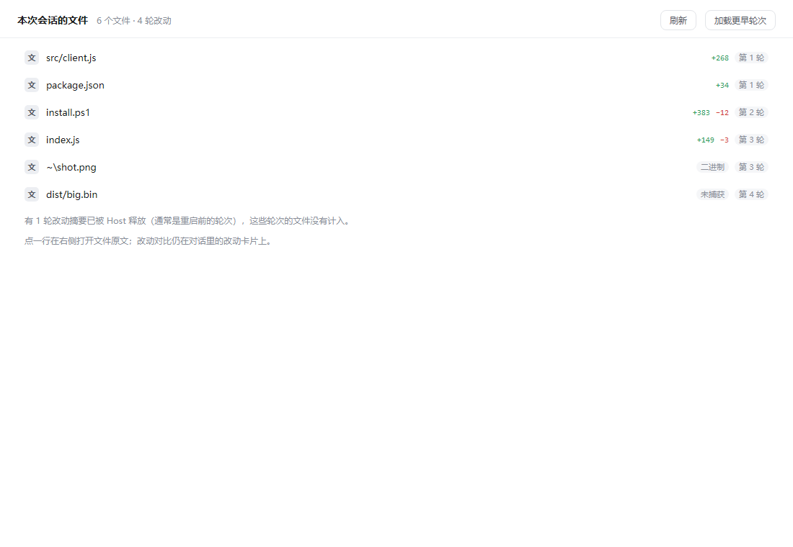

# dsh-session-files

会话顶部 tab 条里的「文件」页：列出**本次会话每一轮改过的文件**，点一行在右侧栏打开**文件原文**。

## 为什么要有它

DSH 里看「这次会话产出了什么」现在没有单一入口：

- 右上角文件夹打开的是整个工作区，不按会话过滤；
- 对话里的文件卡片点开是「第 X 轮改动」的 diff，不是文件当前内容。

这个插件补的是第三个视角：一个按会话聚合的文件清单，点开就是原文。它**不动**原来那两处——不对文件卡片做任何接管，也不改工作区浏览器。



## 数据从哪来

不自己算 diff，直接复用 DSH 已经记录好的每轮改动摘要：

1. 浏览器端从会话事件快照里收集 `workspace/changes` 事件的 `seq`；
2. POST 到 Host 的 `/plugins/dsh-session-files/list`；
3. Host 用 `ctx.workspaceChanges.summary(sessionId, seq)` 逐轮取摘要，按路径合并（计数取最后一轮，首次轮次保留最早）。

因此它和改动卡片同源、同样准确；也同样有那个已知限制——**摘要只活在本次 Host 进程里**，重启前的旧轮次取不到，会显示成「有 N 轮摘要已被 Host 释放」。

## 结构

| 文件 | 作用 |
|---|---|
| `index.js` | Host：一条本地路由，把 seq 列表聚合成文件表 |
| `src/client.js` | 浏览器半边源码：注册 `conversation.view` 的「文件」tab |
| `client.js` | 实际被 DSH 加载的产物，由 `node scripts/build.mjs` 生成 |
| `cordis.patch.yml` | bundle patch，插入 Host 行 |
| `scripts/test-host.mjs` | Host 路由自测（假 ctx，无依赖） |
| `preview/` | 不装插件也能看的离线预览（真实 React + 假数据） |

两个接口细节是照 DSH 源码复刻的，改的时候别动：

- 文件地址：`dsh-resource://file/session/<sessionId>/<相对路径>`，路径按 `/` 分段 `encodeURIComponent`，`%3A` 还原成 `:`；
- 右侧打开：`ctx.sidebarRight.openResource(address)` —— 走的是 document 预览，不是 changes-review。

## 命令

```powershell
node scripts/build.mjs          # src/client.js → client.js
node --check index.js
node scripts/test-host.mjs      # Host 路由自测
node ..\tools\preview\build-session-files.mjs   # 打离线预览（依赖 tools\preview）
```

## 安装

```powershell
# 预览（不改文件）
powershell -NoProfile -ExecutionPolicy Bypass -File .\install.ps1

# 安装到 desktop profile
powershell -NoProfile -ExecutionPolicy Bypass -File .\install.ps1 -Run

# 体检
powershell -NoProfile -ExecutionPolicy Bypass -File .\install.ps1 -Check

# 卸载
powershell -NoProfile -ExecutionPolicy Bypass -File .\install.ps1 -Uninstall -Run
```

**必须重启 DSH** 才加载。手工装法在 DSH 升级或重跑 pnpm install 后可能被清掉，重跑 `-Run` 即可。

## 已知边界

- tab 条在两个以上 View 时才显示；「轨迹」那个 tab 受开发者工具开关控制，与这里无关。
- 摘要来源是 Host 内存，重启后历史轮次不可见。
- 只列「被 git 记录到的改动」：`bash` 重定向、`touch` 这类写不进摘要的操作不会出现，与改动卡片一致。
- 点开走 document 预览，超大文件/二进制会由 DSH 自己给出不可预览提示。
